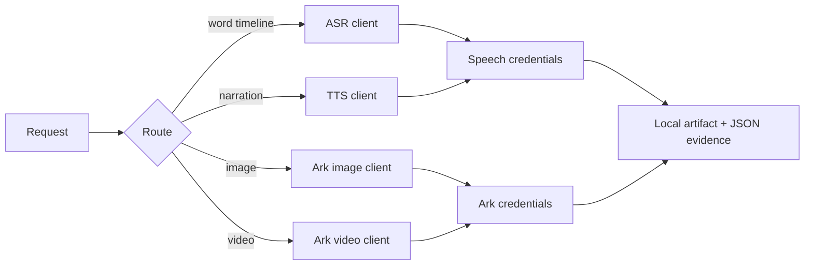

# Volcengine Design

## Plugin marketplaces

This plugin belongs to **AIGC content creation**.

| Category | Marketplace | Purpose |
| --- | --- | --- |
| Full-stack development | [Full Stack Plugins](https://github.com/partme-ai/full-stack-plugins) | Architecture and UI design, code understanding, quality checks, code review, workflow governance, and server operations |
| AIGC content creation | [Full AIGC Plugins](https://github.com/partme-ai/full-aigc-plugins) | Image, video, audio, music, 3D, and multimodal content creation |


> Connect a coding agent to Doubao ASR/TTS, Seedream images, and Seedance video through four deterministic standard-library clients — two independent credential families, explicit cost gates, and submit-once video tasks.

[](https://github.com/full-aigc-plugins/volcengine-design-plugin/releases)
[](#installation)
[](#skills)
[](LICENSE)

[English](README.md) | [简体中文](README.zh-CN.md) · [Install](#installation) · [Quick start](#quick-start) · [Skills](#skills) · [Troubleshooting](#troubleshooting)

## Positioning

`volcengine-design` gives a coding agent the four Volcengine creation capabilities that other pipeline plugins consume: word-level transcription, narration, image generation, and video generation. It exists so that ASR, TTS, Seedream, and Seedance behave the same on Codex, ZCode, and Kimi instead of depending on one host's private integration.

Each capability is a small Python client with no SDK dependency. The agent reads measured JSON output, keeps paid task IDs durable, and never silently retries a billed submission.

| Property | Value |
| --- | --- |
| Plugin ID | `volcengine-design` |
| Version | `0.2.1+codex.20261018` |
| Maturity | Packaged release; no live provider acceptance record is stored in this repository |
| Runtime | Python 3 (standard library only); FFmpeg only for downstream media work |
| MCP server | None; the clients are invoked as scripts or through the slash commands |

## Installation

### Prerequisites

- Python 3 on `PATH`.
- An Ark API key for chat, Seedream, and Seedance: create one at <https://console.volcengine.com/ark> → API Key management.
- A Doubao Speech application for ASR and TTS: AppID plus Access Token from <https://console.volcengine.com/speech/app>.
- Audio and image files must be readable local paths or public URLs as documented per endpoint.

### From the plugin marketplace

```bash
codex plugin marketplace add partme-ai/full-aigc-plugins
codex plugin add volcengine-design@full-aigc-plugins
```

### From the repository-local marketplace

```bash
codex plugin marketplace add full-aigc-plugins/volcengine-design-plugin --ref v0.2.1
codex plugin add volcengine-design@partme-ai-volcengine-design
```

Restart the host and open a new task. ZCode and Kimi load the same plugin through `.zcode-plugin/plugin.json` and `kimi.plugin.json`; their `userConfig` fields inject the credential families.

### Credential families and storage

| Family | Variables | Covers | Where to obtain |
| --- | --- | --- | --- |
| Ark v3 | `ARK_API_KEY` | Chat, Seedream images, Seedance video | <https://console.volcengine.com/ark> |
| Doubao Speech | `VOLCENGINE_APP_ID` + `VOLCENGINE_ACCESS_TOKEN` | ASR and TTS | <https://console.volcengine.com/speech/app> |

Resolution order is the process environment, then the credential files: `~/.volcengine-design/config.json` and a project `.env` (the config file wins when both define a key). On POSIX the config file must be owned by the current user with mode `600`, otherwise the client refuses to read it. A missing family fails fast with the exact console URL to visit; the client never fills in a credential for you.

## Quick start

```bash
# Transcription: submit, wait, then read the millisecond word timeline
python3 scripts/volcengine_asr.py submit --file voice.wav --format wav
python3 scripts/volcengine_asr.py wait --task-id <task-id>
python3 scripts/volcengine_asr.py words --task-id <task-id>

# Narration; long text must be chunked by the caller
python3 scripts/volcengine_tts.py --text "解说词" --speaker zh_female_cancan_mars_bigtts --output narration.mp3

# Seedream image generation, with optional references or sequential mode
python3 scripts/volcengine_ark.py image --prompt "..." --size 2048x2048 --download outputs/images

# Seedance first/last-frame video; persist the task ID before polling
python3 scripts/volcengine_ark.py video-submit --prompt "..." --first-frame first.png --last-frame last.png
python3 scripts/volcengine_ark.py video-wait --task-id <task-id> --download outputs/video.mp4
```

Seedance accepts `--resolution 480p|720p|1080p` and `--ratio 16:9|9:16|4:3|3:4|1:1|21:9|adaptive`. `video-status` reads one task, `video-download` fetches a finished one, and `video-wait` polls until a terminal state; a timeout or failure is reported, never resubmitted.

## What you can build

| Workflow | Built-in path | Verifiable output |
| --- | --- | --- |
| Transcribe speech | `volcengine_asr.py submit` → `wait` → `words` | Word-level millisecond JSON timeline |
| Narrate a cut | `volcengine_tts.py` | Audio file with the requested format and sample rate |
| Generate or edit images | `volcengine_ark.py image` | Image files with references or sequential image sets |
| Generate video | `volcengine_ark.py video-submit` → `video-wait` | Downloaded MP4 plus the persisted task ID |
| Anchor a shot with previs | Seedance `--first-frame` / `--last-frame` | Video interpolated between white-model frames |
| Feed a downstream editor | ASR timeline + TTS audio + generated media | Local assets that Video Factory or JianYing Edit can consume |

## Skills

| Skill | Purpose |
| --- | --- |
| `volcengine-design-use` | Routes transcription, narration, image, and video requests |
| `volcengine-harness` | Calling spec: credential families, cost gates, submit-once discipline |
| `volcengine-audio-spec` | Speech credential families, audio formats, limits, and speakers |
| `volcengine-asr-transcribe` | Doubao big-model ASR with millisecond word timestamps |
| `volcengine-tts-narration` | TTS v3 speaker selection, long-text chunking, download |
| `volcengine-image-generation` | Seedream text-to-image, reference editing, sequential images |
| `volcengine-video-generation` | Seedance `t2v`, `i2v`, `FL2VA`, and reference-image modes |

`volcengine-harness` is plugin-local. The other six are vendored from `volcengine-skills v0.1.0` and pinned per skill by SHA-256 in `skills.lock.json`; edit neither copy in place.

## Slash commands

| Command | What it does |
| --- | --- |
| `/volcengine-setup` | Guides setup of both credential families and their storage |
| `/volcengine-check` | Checks credentials, audio formats, limits, and endpoint reachability |
| `/volcengine-asr` | Transcription: submit → wait → word-level timeline |
| `/volcengine-tts` | Narration: text to a local audio file |
| `/volcengine-image` | Seedream image generation with references or sequential mode |
| `/volcengine-video` | Seedance generation with first/last-frame anchoring |

## Configuration

| Setting | Where it lives | Notes |
| --- | --- | --- |
| Ark key | `ARK_API_KEY` | Environment, project `.env`, or `~/.volcengine-design/config.json` |
| Speech AppID | `VOLCENGINE_APP_ID` | Required together with the access token |
| Speech token | `VOLCENGINE_ACCESS_TOKEN` | ASR sends `Authorization: Bearer; <token>`; TTS sends `X-Api-Access-Key` |
| Config file | `~/.volcengine-design/config.json` | JSON object; POSIX owner and mode `600` enforced |
| Base URL override | `ARK_BASE_URL` | Defaults to the Ark v3 endpoint |

Credentials are read at call time and never written to README files, logs, task records, or artifact manifests. Clients print structured JSON results, not request headers. The speech header format is generated inside the client so that no token appears in a shell argument.

## Architecture and security



| Component | Owns | Does not own |
| --- | --- | --- |
| `scripts/volcengine_config.py` | Credential resolution, file permission checks | Credential issuance |
| `scripts/volcengine_asr.py` | ASR submit, poll, word timeline | Audio editing |
| `scripts/volcengine_tts.py` | TTS v3 synthesis and download | Long-text chunking policy |
| `scripts/volcengine_ark.py` | Chat, Seedream, Seedance task lifecycle | Prompt quality |
| `skills/` (7) | Routing, calling spec, and capability boundaries | Runtime enforcement |

The plugin contacts only the Volcengine endpoints configured above and does not relay traffic to the authors. Discovery and status queries are free; generation is billed. Before a paid video submission the agent restates model, resolution, and duration, persists the `task_id`, and then polls. Failures, timeouts, and ambiguous states are reported, never retried automatically. Seedance rejects mixing first/last frames with reference images, so the client surfaces the endpoint error instead of silently choosing one.

## Troubleshooting

| Symptom | Check first | Resolution |
| --- | --- | --- |
| `ARK_API_KEY` missing | Environment and config file | Export it or add it to `~/.volcengine-design/config.json` |
| Speech credentials missing | Both variables | Set `VOLCENGINE_APP_ID` and `VOLCENGINE_ACCESS_TOKEN` together |
| Config file is rejected on POSIX | Owner and mode | Make it owned by you and `chmod 600` |
| ASR task never finishes | Task status | Query the persisted `task_id`; do not resubmit |
| TTS returns no audio | Speaker name and text length | Use an official speaker and chunk long text |
| Seedance rejects the request | Frame mode | First/last frames and reference images are mutually exclusive |
| Image output is only a URL | `--download` | Pass a directory to save the bytes locally |

## Upgrade

```bash
codex plugin marketplace upgrade partme-ai-volcengine-design
codex plugin add volcengine-design@partme-ai-volcengine-design
```

## Contributing and support

Open functional issues at <https://github.com/full-aigc-plugins/volcengine-design-plugin/issues>. Before proposing a change, state which credential family and endpoint you verified, and whether the change alters a request schema or the submit-once discipline.

## License

Apache-2.0 — see [LICENSE](LICENSE) and [NOTICE](NOTICE). API behaviour is documented from official Volcengine documentation; no upstream code is copied.
