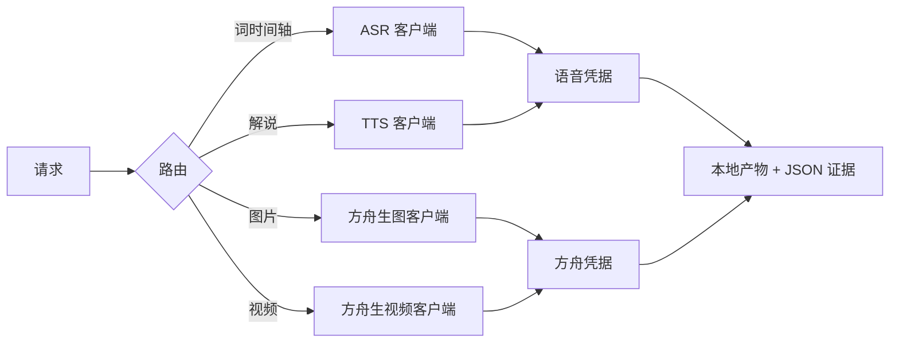

# Volcengine Design

## 插件市场导航

本插件所属分类：**AIGC 内容创作**。

| 分类 | 插件市场入口 | 用途 |
| --- | --- | --- |
| 全栈开发 | [Full Stack Plugins](https://github.com/partme-ai/full-stack-plugins) | 架构与 UI 设计、代码理解、质量检查、代码审查、流程治理与服务器运维 |
| AIGC 内容创作 | [Full AIGC Plugins](https://github.com/partme-ai/full-aigc-plugins) | 图像、视频、音频、音乐、3D 与多模态内容创作 |


> 用四个零依赖的确定性客户端，把豆包 ASR/TTS、Seedream 生图与 Seedance 生视频接进编码智能体：两族凭据彼此独立、计费门禁明确、视频任务只提交一次。

[](https://github.com/full-aigc-plugins/volcengine-design-plugin/releases)
[](#安装)
[](#技能)
[](LICENSE)

[English](README.md) | [简体中文](README.zh-CN.md) · [安装](#安装) · [快速开始](#快速开始) · [技能](#技能) · [故障排查](#故障排查)

## 项目定位

`volcengine-design` 把其他流水线插件要消费的四类火山引擎创作能力交给编码智能体：词级转写、解说配音、生图与生视频。它存在的意义是让 ASR、TTS、Seedream、Seedance 在 Codex、ZCode、Kimi 上表现一致，而不是依赖某个宿主的私有集成。

每类能力都是一个小型 Python 客户端，不依赖官方 SDK。智能体读取实测 JSON 输出，持久保存付费任务 ID，并且绝不会静默重试已计费的提交。

| 项目 | 值 |
| --- | --- |
| 插件 ID | `volcengine-design` |
| 版本 | `0.2.1+codex.20261018` |
| 成熟度 | 已打包发布；本仓库没有保存真实供应商验收记录 |
| 运行环境 | Python 3（仅标准库）；FFmpeg 只在下游媒体处理时需要 |
| MCP 服务器 | 无；客户端以脚本或斜杠命令方式调用 |

## 安装

### 前置条件

- `PATH` 上有 Python 3。
- 方舟 API Key，用于 chat、Seedream 与 Seedance：在 <https://console.volcengine.com/ark> → API Key 管理中创建。
- 豆包语音应用，用于 ASR 与 TTS：在 <https://console.volcengine.com/speech/app> 取得 AppID 与 Access Token。
- 音频与图片必须是可读的本地路径，或各端点文档允许的公网 URL。

### 从插件市场安装

```bash
codex plugin marketplace add partme-ai/full-aigc-plugins
codex plugin add volcengine-design@full-aigc-plugins
```

### 从仓库内置市场安装

```bash
codex plugin marketplace add full-aigc-plugins/volcengine-design-plugin --ref v0.2.1
codex plugin add volcengine-design@partme-ai-volcengine-design
```

重启宿主并新建任务。ZCode 与 Kimi 分别通过 `.zcode-plugin/plugin.json` 与 `kimi.plugin.json` 加载同一插件，由各自的 `userConfig` 注入两族凭据。

### 凭据族与存放位置

| 族 | 变量 | 覆盖 | 获取入口 |
| --- | --- | --- | --- |
| 方舟 v3 | `ARK_API_KEY` | chat、Seedream 生图、Seedance 生视频 | <https://console.volcengine.com/ark> |
| 豆包语音 | `VOLCENGINE_APP_ID` + `VOLCENGINE_ACCESS_TOKEN` | ASR 与 TTS | <https://console.volcengine.com/speech/app> |

解析顺序为进程环境变量、凭据文件：`~/.volcengine-design/config.json` 与项目 `.env`（两处都定义时配置文件优先）。在 POSIX 上，配置文件必须归当前用户所有且权限为 `600`，否则客户端拒绝读取。某一族缺失时会 fail-fast，并给出对应控制台地址；客户端不会替用户填写凭据。

## 快速开始

```bash
# 转写：提交、等待，再读取毫秒级词时间轴
python3 scripts/volcengine_asr.py submit --file voice.wav --format wav
python3 scripts/volcengine_asr.py wait --task-id <task-id>
python3 scripts/volcengine_asr.py words --task-id <task-id>

# 配音；长文本由调用方自行分段
python3 scripts/volcengine_tts.py --text "解说词" --speaker zh_female_cancan_mars_bigtts --output narration.mp3

# Seedream 生图，可选参考图或组图模式
python3 scripts/volcengine_ark.py image --prompt "..." --size 2048x2048 --download outputs/images

# Seedance 首尾帧生视频；轮询前先持久化 task ID
python3 scripts/volcengine_ark.py video-submit --prompt "..." --first-frame first.png --last-frame last.png
python3 scripts/volcengine_ark.py video-wait --task-id <task-id> --download outputs/video.mp4
```

Seedance 支持 `--resolution 480p|720p|1080p` 与 `--ratio 16:9|9:16|4:3|3:4|1:1|21:9|adaptive`。`video-status` 查询单个任务，`video-download` 下载已完成任务，`video-wait` 轮询至终态；超时或失败会如实上报，不会重新提交。

## 可完成的工作

| 工作流 | 内置路径 | 可验证输出 |
| --- | --- | --- |
| 转写语音 | `volcengine_asr.py submit` → `wait` → `words` | 词级毫秒时间轴 JSON |
| 为成片配解说 | `volcengine_tts.py` | 指定格式与采样率的音频文件 |
| 生成或编辑图片 | `volcengine_ark.py image` | 带参考图或组图的图片文件 |
| 生成视频 | `volcengine_ark.py video-submit` → `video-wait` | 下载的 MP4 与持久 task ID |
| 用预演帧锚定镜头 | Seedance `--first-frame` / `--last-frame` | 在白模两帧之间插值的视频 |
| 交给下游剪辑器 | ASR 时间轴 + TTS 音频 + 生成媒体 | Video Factory 或 JianYing Edit 可消费的本地资产 |

## 技能

| 技能 | 作用 |
| --- | --- |
| `volcengine-design-use` | 路由转写、配音、生图与生视频请求 |
| `volcengine-harness` | 调用规范：凭据族、计费门禁、只提交一次的纪律 |
| `volcengine-audio-spec` | 语音凭据族、音频格式、限制与音色 |
| `volcengine-asr-transcribe` | 豆包大模型 ASR 的毫秒级词时间戳 |
| `volcengine-tts-narration` | TTS v3 音色选择、长文本分段与下载 |
| `volcengine-image-generation` | Seedream 文生图、参考图编辑与组图 |
| `volcengine-video-generation` | Seedance `t2v`、`i2v`、`FL2VA` 与参考图模式 |

`volcengine-harness` 为插件自有。其余六个 vendor 自 `volcengine-skills v0.1.0`，由 `skills.lock.json` 按技能固定 SHA-256；两类副本都不要就地修改。

## 斜杠命令

| 命令 | 作用 |
| --- | --- |
| `/volcengine-setup` | 引导配置两族凭据及其存放位置 |
| `/volcengine-check` | 体检凭据、音频格式、限制与端点连通性 |
| `/volcengine-asr` | 转写：提交 → 等待 → 词级时间轴 |
| `/volcengine-tts` | 配音：文本到本地音频文件 |
| `/volcengine-image` | Seedream 生图，支持参考图与组图 |
| `/volcengine-video` | Seedance 生视频，支持首尾帧锚定 |

## 配置

| 设置 | 所在位置 | 说明 |
| --- | --- | --- |
| 方舟密钥 | `ARK_API_KEY` | 环境变量、项目 `.env` 或 `~/.volcengine-design/config.json` |
| 语音 AppID | `VOLCENGINE_APP_ID` | 必须与 Access Token 成对出现 |
| 语音 Token | `VOLCENGINE_ACCESS_TOKEN` | ASR 使用 `Authorization: Bearer; <token>`，TTS 使用 `X-Api-Access-Key` |
| 配置文件 | `~/.volcengine-design/config.json` | JSON 对象；POSIX 上强制校验属主与 `600` 权限 |
| 基础地址覆盖 | `ARK_BASE_URL` | 默认指向方舟 v3 端点 |

凭据只在调用时读取，不会写进 README、日志、任务记录或产物清单。客户端输出结构化 JSON 结果，不打印请求头；语音鉴权头在客户端内部拼接，因此 Token 不会出现在 shell 参数里。

## 架构与安全



| 组件 | 负责 | 不负责 |
| --- | --- | --- |
| `scripts/volcengine_config.py` | 凭据解析与文件权限校验 | 凭据签发 |
| `scripts/volcengine_asr.py` | ASR 提交、轮询与词时间轴 | 音频剪辑 |
| `scripts/volcengine_tts.py` | TTS v3 合成与下载 | 长文本分段策略 |
| `scripts/volcengine_ark.py` | chat、Seedream 与 Seedance 任务生命周期 | 提示词质量 |
| `skills/`（7 个） | 路由、调用规范与能力边界 | 运行时强制 |

插件只访问上面配置的火山引擎端点，不中转流量，也不把流量转给作者。发现与查询免费，生成计费。付费视频提交前，智能体会复述模型、分辨率与时长，先持久化 `task_id`，再开始轮询。失败、超时与不确定状态都会上报，绝不自动重试。Seedance 不允许首尾帧与参考图混用，客户端会返回端点错误，而不是替用户二选一。

## 故障排查

| 现象 | 优先检查 | 处理方式 |
| --- | --- | --- |
| 缺少 `ARK_API_KEY` | 环境变量与配置文件 | 导出该变量，或写入 `~/.volcengine-design/config.json` |
| 缺少语音凭据 | 两个变量是否齐全 | 同时设置 `VOLCENGINE_APP_ID` 与 `VOLCENGINE_ACCESS_TOKEN` |
| POSIX 上配置文件被拒 | 属主与权限 | 改为当前用户所有并 `chmod 600` |
| ASR 任务一直没有终态 | 任务状态 | 查询已持久化的 `task_id`，不要重复提交 |
| TTS 没有返回音频 | 音色名与文本长度 | 使用官方音色，并把长文本分段 |
| Seedance 拒绝请求 | 帧模式 | 首尾帧与参考图互斥，只能二选一 |
| 生图只返回 URL | `--download` | 传入目录，让客户端把字节落盘 |

## 升级

```bash
codex plugin marketplace upgrade partme-ai-volcengine-design
codex plugin add volcengine-design@partme-ai-volcengine-design
```

## 贡献与支持

功能问题请提交到 <https://github.com/full-aigc-plugins/volcengine-design-plugin/issues>。提交变更前，请说明你验证过的凭据族与端点，以及改动是否影响请求 schema 或「只提交一次」的纪律。

## 许可证

Apache-2.0，见 [LICENSE](LICENSE) 与 [NOTICE](NOTICE)。API 行为依据火山引擎官方文档整理，未拷贝上游代码。
